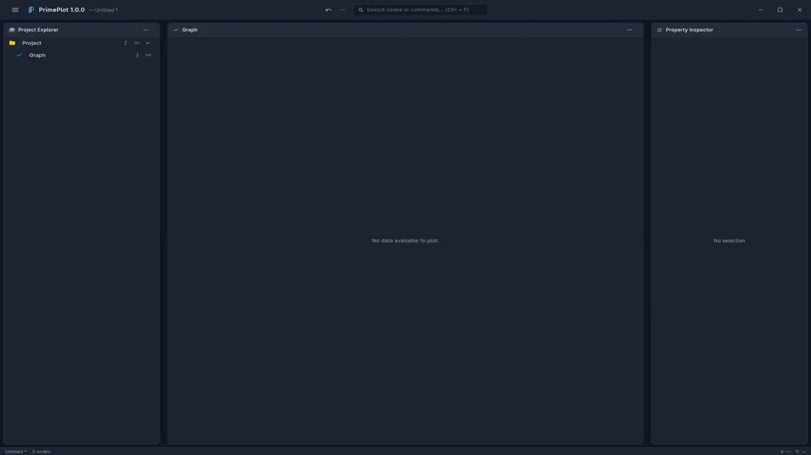
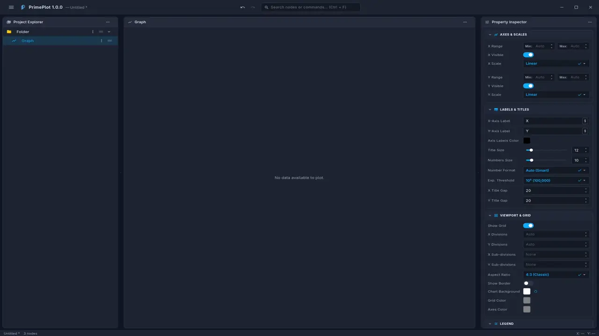

<h1>
  
</h1>

PrimePlot is an open-source desktop application for scientific plotting. It is designed to be fast, lightweight, and responsive, giving scientists, engineers, and technicians a focused tool to turn raw data into clear, publication-quality figures.

> [!IMPORTANT]
> **Alpha status** - The core workflow is functional. Expect rough edges and format changes before the first stable release. Prebuilt binaries are available on the [Releases](https://github.com/filipestevao/PrimePlot/releases) page.

> [!NOTE]
> The Linux AppImage uses FUSE. If FUSE is unavailable, run it with `APPIMAGE_EXTRACT_AND_RUN=1 ./PrimePlot-linux-x86_64.AppImage`.

  

## Features

- **Data management** — Import CSV, TSV, and TXT files by drag-and-drop or file picker. Paste data from the clipboard, edit tables in place, assign X/Y/error/text roles, reorder and resize columns, and browse large datasets smoothly.
- **Transforms** — Apply quick operations such as ln, log10, exp, sqrt, square, reciprocal, and normalize. Add or multiply by a scalar, evaluate custom expressions with a live preview, fill columns with linspace, and inspect live statistics.
- **Plotting** — Plot multiple datasets and functions on one graph. Use linear, logarithmic, or square-root axes with smart major ticks and minor grid lines. Zoom at the cursor, box zoom, pan, autoscale on double-click, and read coordinates from the crosshair.
- **Styling** — Choose a theme and palette, then fine-tune line styles, thickness, markers, and marker sizes. Customize legend position and appearance, LaTeX labels with Greek letters, subscripts, superscripts, and italic/upright control, axis labels, divisions, number formats, typography, frame, grid, and chart background.
- **Workflow** — Organize projects in a tree of folders, graphs, tables, and functions. Undo and redo changes, search nodes and commands, use keyboard shortcuts, and save everything in `.primeplot` project files.
- **Export** — Export publication-ready PNG figures with configurable DPI and an optional transparent background, or export table data as CSV or TSV.

  

## Documentation

- [LaTeX labels](docs/LATEX.md) — Greek letters, italic and upright styles, subscripts, and superscripts.
- [Build from Source](docs/BUILDING.md) — prerequisites and platform-specific build steps.

## Contributing

Bug reports and focused pull requests are welcome.

## License

This project is licensed under the **GNU General Public License v3.0 (GPLv3)**. See the [LICENSE](LICENSE) file for more details.

## Author

Developed by Filipe Estevão.
